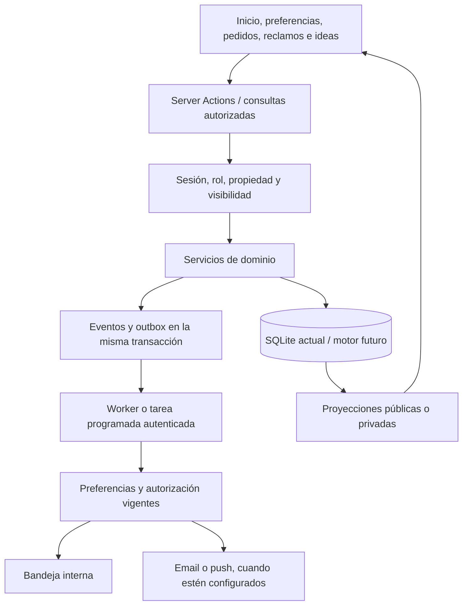
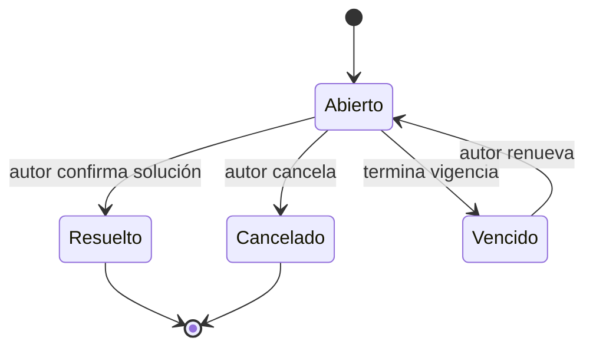
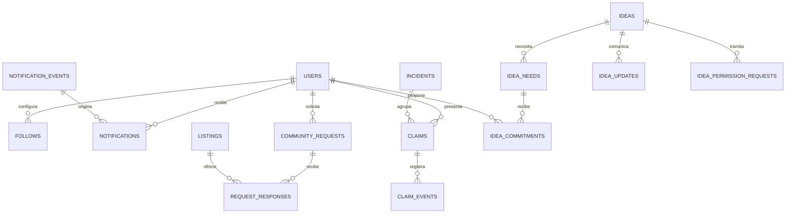

# Sampacho Conecta — Guía de implementación para Claude

Fecha: 18/11/2026 · Autor: Codex · Versión: 1.0

**Estado: especificación propuesta para implementar. Este documento no acredita que las funciones estén terminadas ni probadas.**

## 1. Encargo y alcance

El usuario pidió documentar seis ideas de la propuesta realizada en este chat, para que Claude las incorpore al desarrollo que ya está realizando. La numeración corresponde a esa lista, no a las secciones del HTML original.

| Punto original | Función | Resultado esperado |
|---|---|---|
| 3 | Hoy en Sampacho | Consultar qué importa hoy sin recorrer todo el muro. |
| 4 | Seguir temas, comercios y zonas | Elegir información relevante y cómo recibirla. |
| 5 | Pedidos que conectan con la oferta local | Publicar una necesidad y recibir respuestas de comercios o prestadores. |
| 7 | Reclamos con seguimiento útil | Conocer responsable, última respuesta y próxima actualización; agrupar incidentes internamente. |
| 8 | Ideas que se convierten en acciones | Expresar recursos necesarios y coordinar contribuciones concretas. |
| 12 | Gracias, se resolvió | Cerrar publicaciones con un resultado vinculado al origen. |

### Decisiones confirmadas por el usuario

- El proyecto se piensa con participación municipal desde el inicio. No se verificó convenio, equipo municipal ni disponibilidad operativa real.
- La primera versión debe priorizar comercios y oficios, novedades e información útil.
- Claude está trabajando en la aplicación. Esta entrega es documentación; no sustituye su trabajo ni autoriza descartar cambios existentes.

### Límites de esta ampliación

- Mantener arquitectura, autenticación, componentes e identidad visual existentes salvo incompatibilidad demostrada.
- No incorporar pagos, chat privado propio, contratación automática, recomendaciones por IA ni integraciones pagas como requisito.
- No implementar los otros seis puntos de la lista por asociación. Por ejemplo, disponibilidad de prestadores y préstamo de herramientas no forman parte de este encargo.
- Las decisiones detalladas de este documento son valores iniciales propuestos. La selección de estas seis funciones sí viene del usuario.
- Si una regla contradice la especificación anterior, registrar la diferencia y resolverla explícitamente; no aplicar un cambio silencioso.

## 2. Estado observado e integración con el proyecto

Relevamiento puntual de archivos el 18/11/2026. El código cambia mientras Claude trabaja: volver a verificar antes de editar.

| Evidencia local | Observación verificada | Consecuencia |
|---|---|---|
| [package.json](../web/package.json) | Next.js 16.4.6, React 19.3.0, TypeScript y Zod. | Reutilizar el stack; consultar instrucciones de [AGENTS.md](../web/AGENTS.md) antes de escribir código Next.js. |
| [db.ts](../web/src/lib/db.ts) | SQLite mediante `node:sqlite`; tablas de usuarios, publicaciones, reclamos, fichas, ideas y auditoría. | Proponer migraciones reales sobre la base existente. No asumir Drizzle instalado. |
| [page.tsx](../web/src/app/page.tsx) | Inicio con farmacia, próximo evento y aviso municipal. | Evolucionar ese inicio a «Hoy en Sampacho», sin crear una segunda portada desconectada. |
| [data.ts](../web/src/lib/data.ts) | Consultas de publicaciones, eventos, avisos, reclamos, fichas, ideas y farmacia. | Separar consultas públicas de consultas autorizadas y extender las existentes. |
| [muro.ts](../web/src/actions/muro.ts) | Publicaciones por categoría, comentarios, moderación y estado de venta. | Integrar resultados al muro sin reescribir el módulo. |
| [reclamos.ts](../web/src/actions/reclamos.ts) | Creación, historial, cambio de estado, área y calificación. | Añadir próxima actualización, incidentes compartidos y eventos confiables. |
| [ideas.ts](../web/src/actions/ideas.ts) | Apoyos, enlace de grupo y estados propuesta/en marcha/realizada. | Mantener «Me sumo» y añadir contribuciones concretas como concepto distinto. |
| [auth.ts](../web/src/lib/auth.ts), [constants.ts](../web/src/lib/constants.ts) | Roles vecino, moderador y municipio; helpers de sesión. | No asumir un rol administrador separado que aún no existe. |
| [seguimiento](../web/src/app/reclamos/[id]/page.tsx), [fotos](../web/src/app/api/fotos/[name]/route.ts) | Acceso de reclamos y sus imágenes controlado para autor o municipio. | Extender esta frontera de privacidad a incidentes, respuestas y nuevos adjuntos. |

La memoria anterior todavía describe un scaffold sin funciones. El código inspeccionado ya contiene implementación parcial. Este documento no es una auditoría ni prueba de funcionamiento de esos módulos.

## 3. Estructura común

Mantener el monolito modular. Un servicio de dominio debe validar permisos, aplicar reglas y confirmar datos en una transacción; después se procesa la distribución de notificaciones. Los nombres siguientes son propuestas, no archivos ya existentes.



### Reglas comunes obligatorias

- **Identidad:** obtener usuario y rol de la sesión del servidor, nunca del formulario. Todas las mutaciones exigen sesión válida; suspensión y verificación se aplican según la política real de cuentas del proyecto. No simular verificación en producción.
- **Autorización:** validar lectura y escritura por recurso también en consultas, descarga de fotos, notificaciones y acceso directo por ID. Un botón oculto no es control de permisos.
- **Fechas:** almacenar instantes en UTC; interpretar la fecha civil y mostrar horarios en `America/Argentina/Buenos_Aires`. No calcular «hoy» usando la zona del servidor.
- **Concurrencia:** usar `version` y actualización condicional en estados, recursos y asignaciones. Si otra persona cambió el recurso, devolver conflicto y pedir recargar; no sobrescribir.
- **Idempotencia:** cada creación o transición reintentable recibe una clave de operación ligada a usuario y acción. Un reintento idéntico devuelve el resultado anterior; la misma clave con datos diferentes devuelve conflicto.
- **Transacciones:** dato, historial, auditoría aplicable y evento de dominio se confirman juntos. No hacer llamadas de red dentro de esa transacción.
- **Moderación:** excluir contenido oculto o eliminado de listados, búsquedas, resúmenes y resultados; revalidar también al enviar o abrir una notificación.
- **Datos:** texto tratado como texto, consultas parametrizadas, longitudes y enums validados en servidor. Fotos mediante el mecanismo de carga validado del proyecto; no aceptar rutas arbitrarias.
- **Privacidad:** no poner teléfonos personales, direcciones precisas de viviendas, fotos de reclamos ni enlaces de grupos en payloads públicos, logs o previews de notificaciones.
- **Trazabilidad:** registrar actor, entidad, operación, versión, fecha y motivo cuando corresponda. Evitar copiar descripciones privadas completas a auditoría técnica.

### Contrato de acciones

Cada servicio recibe `input`, contexto de sesión y, cuando corresponda, `expectedVersion` e `idempotencyKey`. El servidor calcula autoría y atributos privilegiados.

Resultado sugerido: éxito con `id`, `version` y estado vigente; error tipado `VALIDATION`, `UNAUTHENTICATED`, `FORBIDDEN`, `NOT_FOUND`, `CONFLICT` o `RATE_LIMITED`, con mensajes en español. Adaptar a `FormState` y convenciones existentes sin hacer una migración transversal innecesaria. En lecturas privadas puede usarse «No encontrado» para no revelar existencia.

## 4. Punto 3 — Hoy en Sampacho

### Experiencia y alcance

El inicio responde «¿Qué necesito saber hoy?». Debe poder usarse sin cuenta. Con sesión puede aplicar zonas e intereses elegidos explícitamente.

Orden inicial:

1. Avisos municipales urgentes vigentes y relevantes para la zona.
2. Farmacia de turno e información útil, con acceso a llamar.
3. Eventos de hoy; luego próximos eventos, claramente diferenciados.
4. Cambios programados de servicios para hoy o las próximas 24 horas.
5. Novedades recientes y resultados comunitarios públicos.

Mostrar pocos elementos por bloque y un enlace «Ver todos». No presentar un próximo evento como si sucediera hoy. La prioridad de un aviso proviene del editor municipal, no de sus likes.

### Requisitos

| ID | Comportamiento |
|---|---|
| RF-HOY-01 | Componer el inicio con contenido público existente, sin duplicar publicaciones. |
| RF-HOY-02 | Un aviso contiene inicio, fin, alcance territorial y nivel informativo/importante/urgente. Solo municipio puede atribuir carácter oficial. |
| RF-HOY-03 | Separar vigencia del aviso de su período destacado: `pinned_until` no equivale a fecha de finalización del hecho informado. |
| RF-HOY-04 | Ocultar avisos cancelados, retirados o fuera de vigencia; conservar archivo claramente fechado. |
| RF-HOY-05 | Mostrar fuente, última actualización y horario del hecho cuando corresponda. Un visitante puede elegir zona manualmente sin compartir GPS. |
| RF-HOY-06 | Si falta farmacia o información del día, mostrar «Todavía no hay información confirmada». Nunca reutilizar silenciosamente el dato de ayer. |
| RF-HOY-07 | Permitir al municipio corregir, cancelar o extender avisos; guardar historial y emitir evento por corrección material. |

### Datos e implementación

Extender `posts` o añadir una tabla 1:1 de metadatos oficiales con `starts_at`, `ends_at`, `severity`, `lifecycle_status`, `updated_at`, `version`. Relacionar zonas por ID validado. Usar `event_end_at` y cancelación para eventos; si falta hora final, tratarlos como evento del día y explicitar ese comportamiento.

Para farmacia, preservar la carga existente por fecha. Si la operación municipal trabaja con turnos que cruzan medianoche, modelar intervalos reales antes de mostrar «Abierta ahora». No inferir apertura solo de estar de turno.

La elegibilidad se calcula al consultar, aunque la tarea de vencimiento no se haya ejecutado. La caché pública nunca mezcla contenido privado ni preferencias de otros usuarios; definir su clave, tiempo de vida e invalidación al editar.

### Aceptación

- A las 00:01 locales cambia el día aunque el servidor esté en UTC.
- Un aviso con fin a las 12:00 no aparece como vigente desde ese instante, incluso sin ejecutar un cron.
- Un aviso oculto desaparece del inicio y de su resumen pendiente.
- Un visitante obtiene información general y puede elegir zona; el permiso de ubicación no es obligatorio.
- Sin registros para el día, se muestra un estado vacío honesto.

## 5. Punto 4 — Seguir temas, comercios y zonas

### Experiencia y alcance

Desde perfil y fichas: «Seguir», «Dejar de seguir» y «Configurar avisos». Seguir es una preferencia informativa, no revela quién sigue a quién ni prueba residencia.

### Requisitos

| ID | Comportamiento |
|---|---|
| RF-SEG-01 | Seguir o dejar de seguir un tema, una ficha comercial/profesional o una zona existente. |
| RF-SEG-02 | Guardar explícitamente el estado deseado; no usar un toggle ambiguo ante reintentos. |
| RF-SEG-03 | Configurar por tipo de aviso frecuencia inmediata/diaria/semanal/desactivada y canales habilitados. |
| RF-SEG-04 | Ofrecer bandeja interna; activar email o push solo con canal configurado y consentimiento correspondiente. Si no existe integración, mostrarla como no disponible. |
| RF-SEG-05 | Aplicar horario de descanso propuesto 22:00–08:00 local, editable. Agrupar avisos ordinarios pendientes; urgentes solo pueden omitirlo si el vecino lo habilitó expresamente. |
| RF-SEG-06 | Incluir motivo de recepción: «Seguís a este comercio» o «Elegiste avisos de esta zona». |
| RF-SEG-07 | Una cuenta que coincide por tema, comercio y zona recibe una sola notificación del mismo evento por canal. |
| RF-SEG-08 | Detener futuros envíos al dejar de seguir o desactivar el canal; al dar de baja la cuenta eliminar suscripciones y cancelar entregas pendientes. |

### Política inicial propuesta

- Bandeja interna como canal inicial. Email y push son etapas posteriores, no requisitos para completar la personalización básica.
- Resumen diario a las 08:00 y semanal los lunes a las 08:00 locales, configurables.
- Con preferencias superpuestas, una ruta inmediata prevalece sobre resumen para ese evento; el resumen excluye eventos ya entregados por el mismo canal.
- Se puede seguir contenido sin habilitar envíos. Mostrar el feed personalizado mediante consultas.
- Las actualizaciones de un reclamo propio son transaccionales y privadas: no dependen de seguir su categoría o zona. La bandeja muestra su historial aunque no haya canal externo activado.

### Datos y entrega

- `follows`: usuario, tipo de destino, destino, fecha; `UNIQUE(user_id, target_type, target_id)`. Validar destino con lista cerrada y existencia, o usar tablas separadas con claves foráneas.
- `notification_preferences`: usuario, clase de evento, frecuencia, canales y descanso. No almacenar tokens de push en una tabla pública.
- `notification_events`: entidad, tipo, versión y referencia mínima. Contenido privado se resuelve bajo autorización al leer, no se copia a un feed público.
- `outbox`: estado, intento, fecha próxima, lease del trabajador y clave única del evento.
- `notifications`: destinatario, evento, leído/enviado y canal; unicidad por evento/usuario/canal. Para resumen, unicidad adicional de usuario/canal/ventana y relación única con cada evento incluido.
- `notification_deliveries` o campos equivalentes: intento, estado, proveedor y error sanitizado. Push endpoints en almacenamiento privado y revocables.

Antes de enviar: volver a verificar suscripción, consentimiento, suspensión/baja, visibilidad y vigencia. Procesar lotes limitados con lease transaccional recuperable. Si falla el proveedor, reintentar con espera creciente y límite; errores permanentes pasan a revisión, sin perder el evento.

La entrega externa puede repetirse si un proceso cae después de enviar y antes de confirmar. Utilizar clave de idempotencia del proveedor cuando exista; no prometer exactamente una entrega. La bandeja interna sí evita duplicados por restricción única.

### Aceptación

- Tres coincidencias producen una notificación interna y una por canal habilitado.
- Reintentar «seguir» mantiene una sola fila; reintentar «dejar de seguir» no vuelve a suscribir.
- Desuscribirse antes del despacho cancela el envío pendiente.
- Un usuario ajeno no puede leer ni marcar como leída la notificación de otra persona.
- Un resumen nunca contiene reclamos privados, teléfonos personales ni enlaces de grupos.
- Reiniciar un trabajador recupera tareas sin multiplicar registros internos.

## 6. Punto 5 — Pedidos que conectan con la oferta local

### Experiencia y alcance

Nuevo espacio «Necesito», enlazado desde inicio, guía y muro. Ejemplos sintéticos: «Busco quien repare una persiana» o «¿Qué comercio tiene este repuesto?».

No es una venta, un reclamo municipal ni una contratación. El solicitante expresa una necesidad; comercios o prestadores vinculados a fichas pueden responder con una propuesta pública y el contacto comercial de esa ficha.

### Requisitos

| ID | Comportamiento |
|---|---|
| RF-PED-01 | Crear pedido con tipo producto/servicio, título, descripción, rubro, zona, fecha límite y hasta 3 fotos opcionales. |
| RF-PED-02 | Listar pedidos abiertos por rubro y zona; buscar por texto y filtrar por vigencia. |
| RF-PED-03 | Responder seleccionando una ficha activa propia y escribiendo disponibilidad o propuesta. No permite atribuirse fichas ajenas. |
| RF-PED-04 | Admitir una respuesta activa por ficha/pedido; editarla o retirarla sin borrar el historial de cambios importante. |
| RF-PED-05 | El autor puede marcar «Encontré una solución», cancelar o renovar al vencer. Elegir una respuesta es opcional y no crea un contrato. |
| RF-PED-06 | Aplicar moderación, denuncia, límites y visibilidad a pedido y respuestas. |
| RF-PED-07 | Notificar al autor una nueva respuesta y a prestadores suscriptos pedidos de su rubro/zona, según preferencias. |
| RF-PED-08 | Ofrecer publicar un resultado vinculado al cerrar, con vista previa. Cerrar no obliga a publicar agradecimiento. |

### Reglas propuestas

- Plazo por defecto 7 días; elección inicial entre 1 y 30 días. No aceptar una fecha vencida al crear.
- Máximo inicial 5 pedidos activos por vecino y 10 respuestas nuevas al día por cuenta; parámetros configurables y verificados en servidor.
- Zona aproximada; no exigir domicilio exacto ni mostrar el teléfono personal del solicitante por defecto.
- La respuesta usa el contacto comercial ya público de la ficha. No revelar teléfonos privados de cuenta.
- Un dueño no responde a su propio pedido; no se habilitan estrellas automáticamente por seleccionar una respuesta.
- Pedido vencido deja de aceptar respuestas por condición de consulta y escritura, sin depender del cron.
- Si la ficha se oculta o elimina, retirar sus datos de contacto de la respuesta pública y detener futuros avisos; conservar la trazabilidad necesaria.

### Estados y datos



Modelar `community_requests` con autor, tipo, rubro, zona, texto, `expires_at`, estado, respuesta seleccionada opcional, visibilidad, `version` y fechas. Separar estado de negocio y moderación.

`request_responses`: pedido, ficha, usuario actor, texto, estado activa/retirada/oculta, versión y fechas; `UNIQUE(request_id, listing_id)`. Al elegir una respuesta, comprobar que pertenece al pedido y sigue elegible dentro de la transacción.

No crear una publicación espejo editable por separado. Si se muestra en el muro, usar una proyección con enlace al pedido canónico y el mismo estado/visibilidad.

### Aceptación

- Un visitante lee pedidos públicos y necesita cuenta para crear o responder.
- No se puede responder con una ficha ajena, oculta o eliminada, ni a pedido vencido/cerrado.
- Dos envíos simultáneos para la misma ficha no crean dos respuestas.
- Seleccionar respuesta de otro pedido devuelve error y no cierra nada.
- Si cerrar y responder compiten, el servidor impide una respuesta posterior al cierre confirmado.
- Resolver muestra «Resuelto» y permite una actualización de resultado; no publica el teléfono del solicitante.

## 7. Punto 7 — Reclamos con seguimiento útil

### Experiencia y alcance

Ampliar el detalle privado existente con área responsable, última respuesta pública para el autor y próxima actualización prevista. Una fecha de actualización no es promesa de reparación.

El municipio agrupa reclamos de un mismo problema en un **incidente interno**. Cada vecino conserva su número y seguimiento; no obtiene acceso a otros reclamos ni a sus autores.

### Requisitos

| ID | Comportamiento |
|---|---|
| RF-REC-01 | Mostrar área, fecha de última respuesta y `next_update_at`, o «Todavía no se informó una próxima actualización». |
| RF-REC-02 | Antes de pasar a revisión/proceso, exigir área y próxima actualización. Propuesta inicial: fecha futura dentro de 30 días, ampliable con motivo. |
| RF-REC-03 | Permitir al municipio actualizar la fecha con explicación; conservar el valor previo en historial. |
| RF-REC-04 | Señalar «Actualización pendiente» si venció la fecha y el reclamo sigue abierto; generar recordatorio interno, no cierre automático. |
| RF-REC-05 | Crear incidente interno, asociar/desasociar reclamos y guardar motivo de agrupación. La coincidencia por ubicación/categoría solo sugiere, nunca fusiona automáticamente. |
| RF-REC-06 | Ofrecer actualización común a los reclamos seleccionados del incidente, con vista previa, preservando sus historiales y acceso individual. |
| RF-REC-07 | Separar notas municipales internas de respuestas visibles para el vecino; las nuevas notas son internas por defecto si no se elige visibilidad explícita. |
| RF-REC-08 | Crear notificación interna real al cambiar información visible. Solo mostrar «Avisamos al vecino» si el registro correspondiente quedó confirmado; envío externo se informa aparte. |
| RF-REC-09 | Registrar asignación, fechas, cambios de estado, asociación y desasociación en auditoría. |

### Política de acceso

- Autor: su reclamo y sus respuestas visibles; nunca miembros, reclamos vecinos ni notas internas del incidente.
- Municipio: gestión de reclamos e incidentes según el permiso existente. Si luego hay áreas restringidas, aplicar esa restricción en servidor y fotos.
- Moderador comunitario: no obtiene acceso a reclamos privados por moderar el muro.
- Visitante u otro vecino: sin acceso, incluso con URL directa o ID de incidente.

### Reglas de agrupación y estados

- Conservar estados actuales `recibido`, `en_revision`, `en_proceso`, `resuelto`, `rechazado`. En esta ampliación se mantiene la regla previa de no reabrir cerrados.
- Transiciones ordinarias: recibido → revisión; revisión → proceso/rechazado; proceso → resuelto/rechazado. Resuelto/rechazado son finales. Actualizar área, fecha o respuesta puede conservar el estado.
- Permitir revisión → resuelto solo como cierre directo con explicación y evidencia de solución; registrar esta excepción, no habilitar cualquier transición.
- Rechazar exige motivo; resolver exige respuesta explicando la solución. Resolver/rechazar limpia `next_update_at` y cancela sus recordatorios pendientes.
- Marcar reclamo como relacionado no significa rechazarlo ni perderlo. Evitar llamar «rechazado» a un duplicado que sigue esperando solución.
- Un reclamo tiene como máximo un incidente activo. No eliminar reclamos para fusionarlos.
- No copiar automáticamente fotos, descripciones o domicilios entre reclamos vinculados.
- Una actualización común genera un evento visible independiente por reclamo, con mensaje neutro sin números ni identidades ajenas.
- El cierre del incidente no cierra reclamos implícitamente. La acción «Resolver reclamos vinculados» muestra selección y motivo antes de confirmar; omite los ya cerrados. Desvincular no borra historia.
- Para lote inicial limitado —propuesta: hasta 100 reclamos— validar versiones y permisos de todos y confirmar todo junto o nada. Para lotes mayores, trabajo por elementos con resultado explícito, sin afirmar éxito total ante errores parciales.

### Datos e implementación

- Extender `claims`: `incident_id` opcional, `next_update_at`, `updated_at`, `version`. Derivar última respuesta del historial visible o mantener proyección consistente.
- Extender `claim_events`: tipo de evento, visibilidad `author/municipal`, valores anteriores relevantes y actor. Los comentarios históricos que ya veía el autor se migran como visibles para él.
- `incidents`: categoría, zona/ubicación interna, área, estado, resumen interno, versión y fechas. Su consulta siempre requiere permiso municipal.
- `incident_events`: asociación/desasociación, decisiones y auditoría de acciones comunes.
- Recordatorios con unicidad por reclamo y versión de fecha; cambiar fecha invalida el recordatorio anterior.
- No usar el barrio de residencia del autor como ubicación del incidente. Registrar la zona del hecho por separado.

El detalle actual consulta historial y sus imágenes por rutas existentes. Añadir allí los filtros de visibilidad y controles del incidente; no crear una ruta alternativa menos protegida.

### Secuencia de una actualización

```mermaid
sequenceDiagram
    actor M as Agente municipal
    participant S as Servicio autorizado
    participant DB as Base de datos
    participant W as Procesador de avisos
    actor V as Vecino autor
    M->>S: Cambiar estado/fecha/respuesta + versión
    S->>S: Validar sesión, permiso y transición
    S->>DB: Transacción: cambio, historial, auditoría, outbox
    DB-->>S: Confirmación o conflicto
    S-->>M: Cambio guardado; estado real del aviso
    W->>DB: Reclamar evento pendiente
    W->>W: Verificar destinatario y privacidad
    W->>DB: Crear notificación interna idempotente
    V->>S: Abrir seguimiento
    S->>DB: Obtener solo reclamo propio y eventos visibles
    S-->>V: Estado, responsable y próxima actualización
```

### Aceptación

- Dos agentes actualizando con la misma versión: uno confirma y el otro recibe conflicto.
- Vencer una fecha genera un recordatorio y no modifica el estado de negocio.
- Agrupar dos reclamos de autores diferentes no permite que se vean entre sí.
- Una nota interna no aparece en HTML, JSON, correo, notificación ni historial del vecino.
- Un moderador no puede acceder al incidente o sus adjuntos.
- Un cambio fallido no deja evento, auditoría de éxito o notificación de cambio confirmado.
- Cambiar la fecha y ejecutar un trabajador viejo no envía el recordatorio obsoleto.

## 8. Punto 8 — Ideas que se convierten en acciones

### Experiencia y alcance

Mantener «Me sumo» como apoyo general. Añadir «Qué hace falta» para contribuciones concretas: personas, materiales, herramientas/espacio o gestión de un permiso. Ejemplo sintético: una jornada necesita 8 personas, 3 palas y autorización para usar un espacio.

### Requisitos

| ID | Comportamiento |
|---|---|
| RF-IDE-01 | El creador define necesidades con tipo, descripción, cantidad/unidad, plazo y visibilidad del compromiso. |
| RF-IDE-02 | Un vecino propone cantidad o disponibilidad para una necesidad, puede retirarla y ve su estado pendiente/aceptada/cumplida/retirada. |
| RF-IDE-03 | El organizador acepta o rechaza propuestas con motivo y confirma lo recibido o realizado. |
| RF-IDE-04 | Mostrar por separado objetivo, compromisos aceptados y aportes efectivamente cumplidos. Un like no incrementa recursos disponibles. |
| RF-IDE-05 | Publicar tareas, fecha/lugar aproximado de actividad y actualizaciones vinculadas a la idea. |
| RF-IDE-06 | El municipio puede registrar estado de revisión de un permiso; solo un actor municipal habilitado marca aprobación/rechazo con referencia y fecha. |
| RF-IDE-07 | Mantener enlace de grupo como vía opcional, visible solo bajo la política de acceso existente. Participar debe ser posible sin WhatsApp. |
| RF-IDE-08 | Cerrar como realizada con explicación; permitir archivar como cancelada con motivo sin fingir realización. Proponer esta ampliación explícita de los estados actuales. |

### Reglas propuestas

- Apoyo, compromiso y cumplimiento son entidades distintas.
- Cantidades enteras positivas para personas y objetos; para cantidades fraccionarias usar unidades y decimal controlado, no flotantes sin validación.
- Las propuestas pendientes no reservan cupo. La aceptación sí lo reserva, en transacción, y no puede superar lo pendiente sin ampliar primero el objetivo con motivo.
- Una persona tiene un compromiso por necesidad y puede actualizarlo; una actualización aceptada que aumente cantidad debe volver a validar cupo. Si está pendiente, requiere nueva aceptación.
- Reducir un objetivo por debajo de lo ya reservado/cumplido exige resolver antes esos compromisos; no ajustar números silenciosamente.
- Cumplimientos parciales admitidos, nunca mayores a lo aceptado. Una contribución ya cumplida no puede retirarse retroactivamente: correcciones llevan motivo e historial.
- Retirar un compromiso no cumplido libera su reserva y avisa al organizador.
- Una idea no pasa a realizada por alcanzar apoyos o reservas; el creador confirma ejecución. Alcanzar el objetivo de recursos tampoco otorga un permiso municipal.
- Nombres y contacto de participantes privados para ellos y el organizador; el público ve cantidades. Reconocimiento nominal solo con consentimiento explícito del participante.
- No aceptar dinero en esta versión. Registrar herramientas o materiales no crea inventario, seguro, contrato de préstamo ni cobro.
- Al cancelar, impedir nuevos compromisos, avisar a participantes y conservar los cumplimientos previos. No convertirlos automáticamente en deudas o reembolsos.
- Validar el enlace de grupo como URL HTTPS con host exacto permitido; no confiar solo en un prefijo. Poder retirarlo/actualizarlo. Mostrarlo a miembros no impide que alguien lo reenvíe fuera de la aplicación.

### Datos

- `idea_needs`: idea, tipo, descripción, cantidad objetivo, unidad, plazo, estado, `version`.
- `idea_commitments`: necesidad, usuario, cantidad propuesta/aceptada/cumplida, estado, visibilidad y fechas; unicidad necesidad/usuario.
- `idea_updates`: idea, autor, tipo, texto, visibilidad y fecha.
- `idea_permission_requests`: idea, descripción, estado pendiente/en revisión/aprobado/rechazado, referencia, actor municipal y fecha. La carga de una aprobación no sustituye el procedimiento administrativo real.
- Extender estado de `ideas` con cancelación y auditoría de transiciones; migrar sin reinterpretar ideas ya realizadas.

### Aceptación

- Apoyar una idea no reserva ni completa recursos.
- Con un cupo restante, aceptar dos propuestas concurrentes confirma solo la que cabe.
- Un aporte propuesto no aparece como recibido; un aporte parcialmente cumplido muestra cantidades reales.
- Un creador no puede aprobar un permiso municipal usando un formulario manipulado.
- Cancelar libera reservas pendientes y conserva evidencia de lo cumplido.
- El listado público no revela teléfonos o nombres de colaboradores sin consentimiento.

## 9. Punto 12 — Gracias, se resolvió

### Experiencia y alcance

Agregar un cierre visible y comprensible en el contenido original. De forma opcional, publicar una actualización de resultado en el muro con enlace al origen cuando este sea público.

Aplicar a pedidos resueltos, publicaciones de objetos/mascotas encontrados, ventas ya vendidas e ideas realizadas. Los reclamos mantienen su cierre privado; sus resultados no se convierten automáticamente en publicaciones.

### Requisitos

| ID | Comportamiento |
|---|---|
| RF-RES-01 | Cambiar estado final con confirmación explícita y actualizar la publicación original en listas, búsqueda y detalle. |
| RF-RES-02 | Ofrecer texto breve y hasta 3 fotos de resultado, con vista previa y opción «Solo cerrar». |
| RF-RES-03 | Si el autor elige publicar, crear un resultado ligado a la fuente canónica, sin duplicar toda su información. |
| RF-RES-04 | Mostrar enlace recíproco origen/resultado cuando ambos son públicos y el lector tiene acceso. |
| RF-RES-05 | Notificar a participantes habilitados según preferencias; no enviar otra vez cada reintento del cierre. |
| RF-RES-06 | Permitir corregir u ocultar el resultado, conservando el estado verdadero del origen y auditoría. |
| RF-RES-07 | Distinguir relato del autor, respuesta municipal y verificación institucional; no otorgar insignias automáticamente. |

### Privacidad de reclamos

- Resolver un reclamo actualiza solo su seguimiento privado y la notificación a su autor.
- Si el municipio quiere comunicar una mejora, crea un aviso público independiente, redactado y revisado por municipio: por ejemplo «Se reparó el alumbrado de la plaza».
- No exponer enlaces, números de reclamo, nombres, domicilios exactos, textos ni fotos privadas en ese aviso. Esta versión no ofrece «hacer público mi reclamo».
- No publicar un contador de afectados ni un mapa de incidentes por defecto; requeriría definir antes criterios de agregación y privacidad.

### Integridad y visibilidad

Un resultado público no puede usarse para publicar contenido que fue ocultado o eliminado. Validar visibilidad de origen y resultado al consultar, no solo al crearlos. Si un origen deja de ser público, retirar su resultado de las superficies públicas. La baja del resultado no reabre el origen.

Usar `community_outcomes` con tipo/id de origen permitido, autor, texto, fotos, estado borrador/publicado/oculto, versión y fechas; un resultado canónico por origen. Validar integridad de referencias polimórficas mediante servicio y pruebas, o preferir claves foráneas separadas con restricción de un único origen.

No añadir `claim_id` ni incidentes privados a esta tabla pública. Para anuncios municipales independientes usar el módulo oficial, sin una referencia privada serializable.

### Aceptación

- Cerrar dos veces el mismo pedido crea un cierre y como máximo un resultado.
- «Solo cerrar» actualiza el estado sin crear una publicación en el muro.
- Marcar una mascota encontrada cambia también el estado del contenido original.
- Un moderador puede ocultar un resultado, pero no atribuir al autor un agradecimiento que no escribió.
- Ocultar/eliminar el origen elimina la exposición pública del resultado y sus previews.
- Resolver un reclamo no crea resultado público ni divulga sus adjuntos.

## 10. Modelo de datos integrado

Esquema conceptual para orientar migraciones; no es SQL listo para ejecutar. Conservar nombres reales de tablas ya existentes y adaptar referencias al motor utilizado.



`community_outcomes` referencia una única fuente pública permitida, por lo que se especifica aparte y no se representa con relaciones que aparenten claves foráneas inexistentes. `outbox` se relaciona con eventos de dominio; su estructura exacta depende de si notificaciones se generan de forma síncrona o por trabajador.

Índices mínimos a revisar con las consultas reales:

- Avisos: estado y rango de vigencia; relación zona/publicación.
- Pedidos: estado, vencimiento, rubro, zona y fecha; respuestas por pedido/ficha con unicidad.
- Reclamos: incidente, estado, área y `next_update_at`; eventos por reclamo/visibilidad/fecha.
- Ideas: necesidades por idea y compromisos por necesidad/estado; unicidad necesidad/usuario.
- Suscripciones: destino/usuario y unicidad; notificaciones destinatario/fecha/leído.
- Outbox: estado/próximo intento/lease; clave de evento única.
- Resultados: fuente única y estado/fecha para feed.

Los índices y el ORM no sustituyen reglas transaccionales. Evitar promedios o contadores desnormalizados en nuevas funciones si no son necesarios; si se agregan, actualizarlos en la misma transacción y probar su reconstrucción.

## 11. Matriz resumida de permisos

«Propio» exige comprobación de propiedad en servidor; un dueño de ficha sigue siendo usuario vecino con relación de propiedad. Municipio no obtiene atribución para publicar textos en nombre de vecinos.

| Acción | Visitante | Vecino | Dueño de ficha | Moderador | Municipio |
|---|---|---|---|---|---|
| Ver inicio y contenido público vigente | Sí | Sí | Sí | Sí | Sí |
| Configurar suscripciones/notificaciones | No | Propias | Propias | Propias | Propias |
| Crear/cerrar pedido | No | Propio | Propio | Propio como vecino | Propio como vecino |
| Responder con ficha | No | Si posee ficha elegible | Propia | Si posee ficha elegible | Si posee ficha elegible |
| Ocultar pedido/respuesta/resultado | No | Retirar propio | Retirar propio | Sí, moderación | Sí, moderación |
| Gestionar aviso oficial | No | No | No | No | Sí |
| Ver reclamo e imágenes privadas | No | Propio | Propio | Solo propio como vecino | Sí |
| Ver notas internas/incidentes | No | No | No | No | Sí |
| Cambiar estado/fecha/área de reclamo | No | No | No | No | Sí |
| Definir necesidades de una idea | No | Si es creador | Si es creador | Si es creador | Si es creador |
| Proponer/retirar compromiso | No | Propio | Propio | Propio | Propio |
| Aceptar/confirmar contribución | No | Creador de idea | Creador de idea | Creador de idea | Creador de idea |
| Aprobar permiso municipal | No | No | No | No | Personal habilitado |
| Publicar resultado de origen público | No | Autor del origen | Autor del origen | Solo origen propio | Solo origen propio |

Las capacidades como vecino de un usuario municipal no permiten gestionar sus propios reclamos para aprobarse una resolución: proponer revisión por otro agente y registrar el conflicto de interés. Si el equipo municipal es de una persona, definir esa excepción operativa explícitamente antes de habilitarla.

## 12. Requisitos no funcionales y pruebas transversales

| ID | Objetivo verificable propuesto |
|---|---|
| RNF-COM-01 | Ninguna lectura/mutación privada concede acceso solo por conocer un ID. Cubrir matriz con pruebas negativas. |
| RNF-COM-02 | Reintentos y concurrencia no duplican cierres, respuestas, reservas ni bandeja interna; probar con peticiones paralelas y fallos inducidos. |
| RNF-COM-03 | Inicio y listados paginados, sin consultas por cada tarjeta; medir tiempo de servidor p95 menor a 500 ms con conjunto de prueba representativo y 50 lectores concurrentes en entorno documentado. Es objetivo, no rendimiento actual garantizado. |
| RNF-COM-04 | Formularios con etiquetas, navegación por teclado, foco de error y estados anunciados por lector; los estados usan texto además de color. Comprobar en móvil de 360 px y zoom de 200 %. |
| RNF-COM-05 | Tras confirmar un cambio, la vista propia refleja el estado guardado; la portada pública lo refleja en hasta 60 s. Un aviso vencido nunca se clasifica vigente por depender solo de limpieza programada. |
| RNF-COM-06 | Si falla una integración externa, el negocio permanece confirmado y el aviso queda pendiente/fallido de forma observable. No mostrar «enviado» sin evidencia. |
| RNF-COM-07 | Cachés compartidas, metadatos sociales y service worker no almacenan reclamos ni notas internas. Respuestas privadas con política de caché apropiada y limpieza al cerrar sesión. |
| RNF-COM-08 | Cada migración puede aplicarse sobre una copia de la base existente preservando datos; segunda ejecución no duplica cambios y el fallo no deja versión parcialmente aplicada. |

### Casos de prueba mínimos por etapa

- **HOY:** medianoche argentina, fin exacto de vigencia, cancelación, falta de farmacia y contenido moderado.
- **SEG:** seguimientos repetidos, preferencias superpuestas, baja durante cola, descanso, resumen y acceso a bandeja ajena.
- **PED:** propiedad de ficha, duplicados concurrentes, vencimiento, respuesta de pedido ajeno y cierre concurrente con respuesta.
- **REC:** privacidad de historial/fotos/incidente, versiones en conflicto, recordatorio obsoleto y lote con conflicto parcial.
- **IDE:** sobreasignación concurrente, cantidades inválidas, cumplimiento parcial, retirada, cancelación y aprobación municipal falsificada.
- **RES:** cierre sin publicar, doble cierre, moderación del origen y ausencia de publicación automática de reclamos.
- **Integración:** acciones de dominio crean evento/outbox solo si se confirma la transacción; error del proveedor no revierte el negocio.

Pruebas E2E principales: consultar hoy → seguir zona → recibir aviso interno; crear pedido → responder con ficha → resolver → publicar resultado; crear reclamo → agente actualiza → autor ve fecha/respuesta; proponer idea → aceptar compromiso → confirmar cumplimiento → publicar realización.

No añadir pruebas que solo reproduzcan el código. Priorizar invariantes, autorización y comportamiento observable. Elegir herramientas ya disponibles; si no hay runner, añadir uno justificado como parte de la implementación, no afirmar que existe por figurar en el diseño anterior.

## 13. Migraciones, operación y compatibilidad

1. Antes de editar, leer memoria e instrucciones aplicables, revisar Git y confirmar qué cambió desde este relevamiento. Coordinar con el trabajo actual de Claude; no resetear ni reemplazar archivos ajenos.
2. Crear una copia segura de la base para probar. No borrar `data/`, usuarios, imágenes ni reclamos para «actualizar el esquema».
3. El esquema `CREATE TABLE IF NOT EXISTS` observado no actualiza columnas de tablas existentes. Incorporar migraciones numeradas y registro de versión antes de depender de campos nuevos.
4. Agregar columnas inicialmente compatibles/nullables o con defaults seguros, hacer backfill verificado y luego endurecer restricciones. Probar claves foráneas y checks con el motor real.
5. Para fechas antiguas, documentar formato y zona original antes de convertirlas. No reinterpretar silenciosamente `event_at` local como UTC.
6. Mantener el historial público previo de reclamos visible al autor; crear la distinción de notas internas solo con clasificación explícita.
7. Introducir activación por función para entregar por etapas. Desactivar UI no sustituye autorización. Una función desactivada debe rechazar también mutaciones que ya no se ofrecen.
8. No basar vencimientos solo en un cron. Usar filtros de fecha en lectura/escritura; cron para recordatorios, resúmenes y limpieza.
9. Definir dónde ejecutará el trabajador, cómo se autentica y cómo reclama una tarea con lease. No asumir que un proceso web mantiene tareas en memoria entre despliegues.
10. Probar restauración y recuperación de cola; ante rollback de aplicación, preferir migraciones aditivas compatibles. No revertir columnas con datos nuevos sin un plan específico.
11. No cambiar SQLite por PostgreSQL ni autenticación como requisito de estas seis funciones. Si el despliegue exige otro motor, planificar y probar esa migración por separado.

### Operación municipal necesaria

Antes de publicar información real: designar responsables para farmacia/avisos, bandeja de reclamos, cobertura por ausencias y revisión de información vencida. La intención municipal confirmada por el usuario no significa que estas personas ya estén asignadas.

Tablero operativo mínimo: avisos sin vigencia válida, próximas actualizaciones vencidas, notificaciones fallidas, pedidos denunciados y propuestas con compromisos pendientes de revisión. Mostrar cifras agregadas solo a roles habilitados; no exponer detalles privados en estadísticas públicas.

## 14. Orden de implementación para Claude

| Etapa | Entregable | Dependencias y cierre |
|---|---|---|
| 0 | Reconciliar código, migraciones y permisos | Registrar baseline, preservar datos, acordar nombres y política de eventos. |
| 1 | Hoy en Sampacho | Extender portada y vigencias; pruebas de fechas/moderación. Mayor prioridad del usuario. |
| 2 | Seguimientos, feed personalizado y bandeja interna | Suscripciones, preferencias y evento/outbox mínimo. Canales externos después. |
| 3 | Pedidos locales + cierre básico | Pedido/respuestas con permisos, estados y «Solo cerrar». |
| 4 | Resultados vinculados | Reutilizar cierres de pedidos y estados existentes; privacidad de reclamos excluida del feed. |
| 5 | Seguimiento municipal ampliado | Fechas/responsables/notas; luego incidentes y acciones comunes. Requiere eventos y controles privados. |
| 6 | Ideas con recursos y compromisos | Necesidades, aceptación concurrente, permisos y cierre vinculado a resultados. |
| 7 | Resúmenes, email/push y operación | Proveedor configurado, consentimiento, trabajador y observabilidad probados. |

Se puede ajustar el orden si Claude ya terminó una dependencia. Entregar cortes funcionales completos en lugar de agregar todas las tablas sin cerrar flujos. No hay estimación de semanas comprometida: depende del estado que Claude confirme, pruebas y capacidad operativa.

### Definición de terminado por función

- Datos y migración aplicados sobre base existente de prueba, con integridad verificada.
- Servicio, autorización y consultas implementados; interfaz con vacío/carga/error/éxito/conflicto.
- Criterios de aceptación de su sección aprobados, incluidos casos negativos y concurrencia relevantes.
- Notificaciones muestran estado real; los canales todavía no integrados quedan explícitamente pendientes.
- `lint` y `build` del proyecto ejecutados cuando corresponda; registrar PASS/FAIL con explicación de fallos previos o nuevos.
- Memoria y handoff actualizados con archivos, decisiones, migraciones, pruebas y pendientes. No declarar todo terminado por tener pantallas con datos de ejemplo.

## 15. Instrucción breve para pasarle a Claude

> Leé `docs/IMPLEMENTACION_FUNCIONES_COMUNITARIAS_CLAUDE.md` y contrastalo con tu implementación actual. Incorporá por etapas las seis funciones seleccionadas: Hoy en Sampacho; seguimiento de temas, comercios y zonas; pedidos locales; seguimiento municipal ampliado de reclamos; ideas con contribuciones concretas; y resultados vinculados «Gracias, se resolvió». Priorizá guía, novedades e información útil. Reutilizá lo que ya construiste, preservá datos y cambios existentes y actualizá `.ai-memory/`. Antes de cada etapa identificá las diferencias con la especificación previa. Implementá permisos y pruebas junto con el flujo, especialmente privacidad de reclamos, idempotencia y cupos concurrentes. No publiques resultados de reclamos privados en el muro ni anuncies envíos que no estén confirmados. Dejá explícito qué queda implementado, probado y pendiente.

## 16. Estado de esta entrega

Se redactó esta guía a partir del pedido y de un relevamiento de código, sin modificar la aplicación. Los requisitos, entidades nuevas, pruebas y etapas descritos son trabajo propuesto para Claude. La validación de esta entrega es documental; no se ejecutaron build, migraciones ni pruebas de aplicación.
